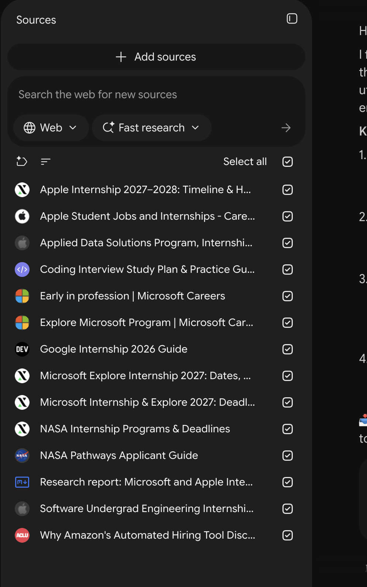

# AI_Pre-Apprenticeship_NoteBookLM
An AI-powered career guidance workflow built with Google NotebookLM. It supports interview preparation, career planning, and skills gap identification to help users prepare for employment opportunities. 

# Meet Jit Career Coach 
## 1. Project Overview
Jit Career Coach is an AI-powered assistant designed to help students, job seekers, and individuals preparing to enter the workforce. Built using Google NotebookLM. Jit helps users identify skill gaps, understand job requirements, prepare for mock job interviews, and create actionable 30/60/90-day career development plans. The purpose of Jit is to make career preparation and career transition easier, more organized, and accessible by using trusted career resources and target job descriptions.

## Career Pathway: Software Engineering

## Built with: Google NotebookLM

## 2. The Problem I'm Solving
Many students, pre-apprenticeship participants, and job seekers struggle to understand employer expectations, identify the skills needed for specific careers, and prepare for job interviews. Without proper guidance, it can be difficult to know where to start, what skills to develop, or how to prepare for employment opportunities. Using Google NotebookLM, I created Jit Career Coach to help address these challenges by providing career guidance, interview preparation, skills gap identification, and structured career development plans. The goal is to make career preparation more accessible and easier, and to help users feel more confident as they work to achieve their professional goals. 

## 3. How My AI Career Coach Works
I used Google NotebookLM to research and generate career resources for software engineering opportunities at leading technology companies such as Apple, Microsoft, Google, and NASA. I asked Jit Career Coach to explore software engineering roles, identify potential job responsibilities, and highlight the technical skills and qualifications required for these roles. The resources helped me understand the software engineering career pathway, employer expectations, and skills necessary to prepare for future employment opportunities. 

## Career Resources Generated by Jit Career Coach
Below is a screenshot of some of the software engineering career resources generated by Jit Career Coach using Google NotebookLM. 

## 4. Jit In Action
I tested Jit Career Coach using career-related prompts and a real software engineering internship opportunity to explore how AI can help with job preparation and recommended preparation.

**4.1 Career Guidance**

**My AI prompt:**  
"Looking at this job description, can you tell me how I will be evaluated for this role, such as the interview rubric and so forth? Be a recruiter and check if my resume fits the job description"

**Job Description Used:**

Google Software Engineering Internship - United States

I provided Jit with information from Google's internship posting, including: 

      Applications are reviewed on a rolling basis. 
  
      The anticipated deadline is September 25, 2026, although the posting may close earlier.
  
      Application decisions may take 90 days or longer. 
  
      The internship is intended for students pursuing a bachelor's degree in Computer Science or 
      related field. 
  
      English proficiency is required for effective collaboration.

**What Jit Helped Me Understand**

Jit helped me better understand the job requirements, how recruiters might evaluate applicants, and how my resume could align with the position. It also helped me recognize the importance of having the right technical skills and qualifications when applying for internship roles. Jit to identify

  
